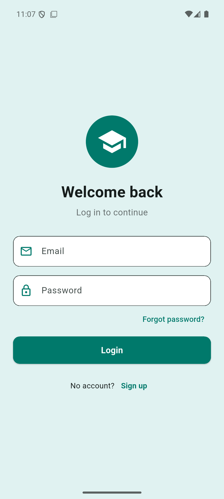
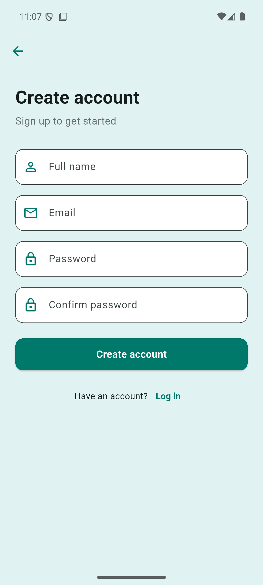

# Project 2: Login & Sign Up

Lectures 5 to 9. UI only: the buttons don't do anything, only the navigation
between the two pages works.

| Login | Sign up |
|---|---|
|  |  |

## Pages

- **Login** ([`lib/pages/login_page.dart`](lib/pages/login_page.dart)): logo, title, Email and Password fields, "Forgot password?", a Login button and a Sign up link.
- **Sign up** ([`lib/pages/signup_page.dart`](lib/pages/signup_page.dart)): back arrow, title, Full name, Email, Password, Confirm password, a Create account button and a Log in link.

## Navigation

- **Sign up** opens the Sign up page (`Navigator.push`).
- **Log in** and the **back arrow** go back to the Login page (`Navigator.pop`).

## Custom widgets

Built once in [`lib/widgets`](lib/widgets) and used on both pages:

- [`AppTextField`](lib/widgets/app_text_field.dart): label, icon, and an option to hide the text for passwords.
- [`AppButton`](lib/widgets/app_button.dart): full-width button with a text and an `onPressed`.

## No overflow with the keyboard open

Both pages are inside a `SingleChildScrollView`, so they scroll when the
keyboard opens. A widget test checks this on a small screen (360 × 640) with
the keyboard open.

## Run

```bash
flutter pub get
flutter run
```

Tests: `flutter test`
